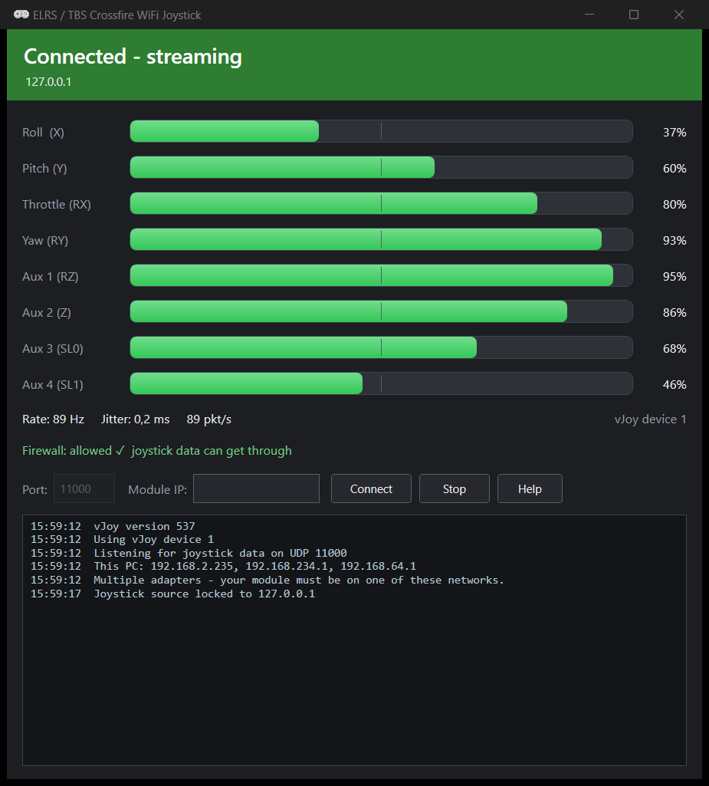

# ExpressLRS / TBS Crossfire WiFi Joystick for Windows

<div align="center">

**Use your ExpressLRS or TBS Crossfire/Tracer radio as a wireless joystick on Windows — with a live visual app**

[](https://github.com/juricabi/ELRS-Crossfire-WiFi-Joystick-Windows/actions/workflows/build.yml)
[](https://dotnet.microsoft.com/download/dotnet/6.0)
[](https://www.microsoft.com/windows)
[](LICENSE)



</div>

This app turns your **ExpressLRS (ELRS)** *or* **TBS Crossfire / Tracer** TX module's WiFi output into a virtual joystick (via vJoy), so you can fly flight simulators like VelociDrone, Liftoff, or DRL — **wirelessly, no cables** — plus anything on Windows that takes joystick input.

Both radios use the same "WiFi joystick" protocol (the one VelociDrone Mobile speaks), so setup is identical: put the module on your WiFi and run the app. The only difference is the discovery beacon — ELRS announces itself as `ELRS`, Crossfire as `VELOCIDRONE` — and the app handles both automatically.

> **v3.0** is a ground-up WPF interface: vector-rendered, so it is pixel-perfect on **any** display scale (100/125/150/200%), with GPU-composited live axis bars, packet rate + jitter, connection status, and one-click firewall setup. It still auto-discovers your module and just works.
>
> **v3.3**: the **rate and channel count are settings** - ELRS is asked for **250 Hz × 16 channels** by default (was 100 Hz × 8), adjustable live - and **CH9-CH16 are joystick buttons 1-8**.

> 🐧 **On Linux?** [ELRS-Crossfire-WiFi-Joystick-Linux](https://github.com/juricabi/ELRS-Crossfire-WiFi-Joystick-Linux) does the same there (uinput joystick, terminal UI and a web page), with the same protocol behaviour, defaults and axis order.

## ✨ Features

- 🎮 **Virtual joystick** - creates a Windows vJoy device from your radio's WiFi output
- 📡 **ELRS + Crossfire/Tracer** - full support for the ELRS/Crossfire WiFi joystick protocol (16 channels, 15-bit)
- ⚡ **Adjustable rate & channels** - asks ELRS for 250 Hz × 16 channels by default; pick 1000/500/333/250/200/150/100/50 Hz and 4-16 channels, applied live (see [Rate & channels](#-rate--channels))
- 🔘 **Buttons** - CH1-CH8 are the 8 vJoy axes, CH9-CH16 joystick buttons 1-8 (with hysteresis, so a switch never flickers)
- 🖥️ **Live visual app (WPF)** - real-time GPU-composited axis bars, packet **rate + jitter**, and connection status at a glance
- 🌐 **Auto-discovery** - detects and activates ELRS *and* TBS Crossfire/Tracer modules automatically (or type the IP)
- 🛡️ **One-click firewall** - detects and adds the required Windows Firewall rule for you (the #1 "no data" cause)
- 🔒 **Single-source lock** - if two modules are on the network, only one drives the joystick; pick a specific one by IP
- 📉 **Accurate metrics** - high-resolution jitter/rate measurement
- ❓ **Built-in Help** - a Help button with short tutorials for every feature
- 🪶 **Light & CPU-friendly** - minimize to the system tray to pause the on-screen bars and drop CPU to ~1% (the joystick keeps working); single-instance
- 📦 **No install** - self-contained single-file `.exe`, runs on Windows 7 SP1 through Windows 11 (64-bit)
- ⌨️ **CLI edition too** - `ELRSWifiJoystickCli.exe` (~9 MB, instant start): the same engine and features in a console app - live channel readout, stats, firewall handling, `--tx`, `--rate`, `--channels`, plus interactive keys while running (`s` start/stop, `t` module IP/connect, `p` port, `r` rate, `c` channels, `a` restart the stream, `f` firewall, `q` quit; also scriptable via stdin)
- 🖥️ **DPI-perfect** - WPF vector rendering: crisp on every display scale (100/125/150/200%), including per-monitor DPI

## 🚀 Quick Start

### Option 1: Download Pre-built Release (Recommended)

1. **Download** the latest release from the [Releases page](../../releases)
2. **Install vJoy** - [2.1.9.1](http://vjoystick.sourceforge.net/) or [2.2.x](https://github.com/BrunnerInnovation/vJoy/releases) - both work
3. **Extract** the ZIP file and run `ELRSWifiJoystick.exe`
4. **Connect** your ELRS TX module to WiFi

> **Note**: The release package includes everything needed - no .NET installation required!

### Option 2: Build from Source

#### Prerequisites

- **vJoy Driver** - [2.1.9.1](http://vjoystick.sourceforge.net/) or [2.2.x](https://github.com/BrunnerInnovation/vJoy/releases) - both work
- **.NET 6.0 SDK** - Download from [dotnet.microsoft.com](https://dotnet.microsoft.com/download/dotnet/6.0)

#### Build Steps

1. **Clone** this repository

2. **Setup vJoy Libraries**
   - Install vJoy (see above)
   - Copy `vJoyInterfaceWrap.dll` and `vJoyInterface.dll` from `C:\Program Files\vJoy\x64\` to the `lib\` folder
   - The bundled `vJoyInterface.dll` is only a fallback: at runtime the app loads the one from the user's
     vJoy install, so it always matches their driver whichever vJoy version you built with

3. **Build the Application**
   
   **Option A: Using Build Scripts (Recommended)**
   ```bash
   # Development build (multiple files, good for testing)
   .\build.bat
   
   # Production build (single executable, good for distribution)
   .\publish.bat
   ```
   
   **Option B: Manual Commands**
   ```bash
   # Development build
   dotnet build -c Release
   
   # Production build (single executable)
   dotnet publish -c Release -r win-x64 --self-contained true -p:PublishSingleFile=true
   ```

### Build Scripts Explained

| Script | Purpose | Output | Use Case |
|--------|---------|--------|----------|
| `build.bat` | Development build | Multiple files (DLLs, runtime, etc.) | Testing, debugging, development |
| `publish.bat` | Production build (GUI) | Single executable + ZIP distribution | Distribution, deployment |
| `publish-cli.bat` | Production build (CLI) | Trimmed ~9 MB console exe + ZIP | Lightweight/headless use |

**build.bat** creates a development build with separate files, making it easier to debug and modify.  
**publish.bat** creates a single-file executable perfect for distribution to end users.

### Running the Tests

The engine and the view model have a full xUnit test suite (`ELRSWifiJoystick.Tests/`)
covering the protocol (beacons, channel frames, malformed packets), the source-lock state
machine (and the centering when the lock goes), activation throttling, the request (rate/channels) and stream restarts
(the rules R1-R13 at the top of `JoystickEngine.cs`, the same as the Linux version's), the channel
to axis/button mapping, rate/jitter math, socket-level lifecycle (restart, port-in-use, clean
shutdown), both command lines, and the UI state mapping (banner, axis bars, drop-downs, log
capping). Tests inject a fake clock/output/activator, so they need neither vJoy nor a module.
GitHub Actions builds the GUI and the CLI and runs the tests on every push
(`.github/workflows/build.yml`, which takes the vJoy DLLs from the vJoy 2.1.9.1 installer):

```bash
dotnet test ELRSWifiJoystick.Tests -c Release
```

## 🔧 Configuration

### vJoy Setup

1. Install vJoy - [2.1.9.1](http://vjoystick.sourceforge.net/) or [2.2.x](https://github.com/BrunnerInnovation/vJoy/releases) - both work

### ExpressLRS TX Module Setup

1. **Connect to WiFi**:
   - Put your ELRS TX module in WiFi mode
   - Connect to the TX module's WiFi access point OR connect it to your local WiFi network

2. **Access Web Interface**:
   - Open `http://10.0.0.1` or `http://elrs_tx.local` in your browser
   - ELRS should automaticaly send data for WIFI gamepad if connected

### TBS Crossfire / Tracer Setup

Setup is the same as ELRS — the module just needs to be on the same WiFi network. This uses
the "Velocidrone Mobile" support built into the TBS WiFi module.

> ### 🛑 Check your firmware first
>
> | Component | Works | Broken |
> |-----------|-------|--------|
> | **Crossfire TX (XF)** | **6.31**, **6.36** | **6.42 public, 6.48 beta, 6.48 public** |
> | **WiFi module** | **v2.17** up to **v3.10** (v2.25.49mb recommended) | **v3.20** |
>
> On a broken version the module streams normally but **never sends stick data** — this app,
> VelociDrone Mobile, and every other client see the same dead stream, and nothing on the PC
> side can fix it. Details and source:
> [firmware compatibility](#-crossfire-firmware-compatibility-important).

1. **Connect to WiFi**:
   - Enable WiFi on the Crossfire/Tracer TX (WiFi module powered).
   - Either connect the module to your local WiFi network (recommended), or connect your PC
     to the module's own access point (`tbs_crossfire_XXXXXXXXXXXX` / `192.168.4.1`).
   - Your PC and the module must be on the same network.

2. **Run the app** — no extra configuration needed:
   - The module continuously broadcasts a `VELOCIDRONE` discovery beacon (~every 8 s). The
     app detects it and automatically sends the activation request, then starts receiving
     channel data.
   - To skip the beacon wait and activate instantly, pass the module's IP:
     `ELRSWifiJoystick.exe --tx 192.168.2.138`
     (find the IP on the module's WiFi web page).

> **How it works:** the app POSTs `action=joystick_begin` to the module's `/udpcontrol`
> endpoint — the same request ELRS uses — and the module streams RC channels over UDP on
> port 11000. No radio-to-FC wiring, MAVLink, or ground-control software is involved; the
> WiFi module sends stick data directly.

## 🎮 Usage

1. **Run `ELRSWifiJoystick.exe`.** The app opens, initializes vJoy, and starts listening
   automatically. The first time, accept the one-time Windows permission (UAC) prompt so the
   firewall lets the joystick data through.

2. **Watch the status banner:**
   - 🟠 *Searching for module…* — make sure your module is on the same WiFi.
   - 🟢 *Connected — streaming* — the axis bars move with your sticks, and you'll see the
     packet **rate** and **jitter**.

3. **Use in your flight simulator:** open VelociDrone / Liftoff / DRL etc., select
   **"vJoy Device"** as the controller, and calibrate the axes.

4. **Optional controls:**
   - **Module IP** — leave blank for auto-discovery, or type your module's IP and press
     **Connect** to target a specific module (skips the beacon wait; find the IP on the
     module's WiFi web page). **Stop** clears it (`s` in the CLI too), so the next Start
     auto-discovers again: type the IP and Connect to target the module again.
   - **Port** — the UDP port (default `11000`); change it while stopped.
   - **Rate / Channels** — what the module is asked for (default **250 Hz**, **16 channels**);
     ExpressLRS takes a change by restarting its stream (see [Rate & channels](#-rate--channels)).
     Disabled while connected to a Crossfire module, which ignores them.
   - **Allow in Firewall** — appears, next to *"Firewall may block joystick data"*, only while the
     firewall rule is missing: click it and accept the Windows prompt.
   - **Help** — opens short tutorials for every feature.
   - Minimizing to the tray pauses the on-screen bars and drops CPU to ~1% — the joystick
     keeps working, so **minimize while flying** for best performance.
   - When the stream stops (3 s without data: radio off, out of range) or you **Connect** to
     another module, the vJoy axes go to the center and its buttons are released, so the sim never
     keeps a stale stick or switch; they follow the sticks again as soon as data is back. Stopping
     and closing the window do the same before the device is let go. Shorter gaps hold the last
     values, and **Connect** to the module that streams now changes nothing.

**Command-line (optional):** `ELRSWifiJoystick.exe [port] [--tx <module-ip>] [--rate HZ | --interval US] [--channels N]`
— e.g. `ELRSWifiJoystick.exe --tx 192.168.2.138` pre-fills the module IP on launch, and
`--rate 500 --channels 8` (or `--rate=500 --channels=8`) starts with 500 Hz and 8 channels. A
mistake - a value that is not supported, a missing value, an unknown option, a module IP that is
not `a.b.c.d` - is reported in a message box, which says what the app uses instead.

> **Stopping the module's stream:** once activated, the module keeps broadcasting channel data
> until it is powered off, rebooted, or its WiFi drops. Closing this app only stops *reading*
> the stream. ELRS has a remote stop command (`joystick_end`), which the app sends only to
> restart the stream with a new rate or channel count. How Crossfire responds to `joystick_end`
> is unknown, so the app does not send it one (to a module known as Crossfire by its beacon).

## ⚡ Rate & channels

The activation POST asks the module for an update **rate** (as an interval) and a **channel
count** - "the request". Defaults: **250 Hz** (4000 µs) and **16 channels**.

| Rate | 1000 Hz | 500 Hz | 333 Hz | **250 Hz** | 200 Hz | 150 Hz | 100 Hz | 50 Hz |
|------|---------|--------|--------|------------|--------|--------|--------|-------|
| Interval (µs) | 1000 | 2000 | 3000 | **4000** | 5000 | 6667 | 10000 | 20000 |

Channels: **4 to 16**. The GUI offers these values in two drop-downs; on the command line
(`--rate`, `--interval`, `--channels`, GUI and CLI) any rate from 10 to 1000 Hz (interval
1000-100000 µs) works.

- **ExpressLRS** (3.4.0 and later) streams what it is asked for, but takes a new request only
  while it is not streaming: a request to a streaming module just moves the stream. So when you
  change the rate or the channels while a module that is surely ELRS streams to the app - known
  by its beacon, or streaming a channel count other than 16, which Crossfire never sends - the
  app **restarts its stream** at once: it POSTs `action=joystick_end`, then `joystick_begin`
  with the new values (`Restarting the stream of <ip>: 500 Hz, 16 channels`). The joystick
  holds its position for that moment and the source lock stays.
- **TBS Crossfire / Tracer** starts on the same request but **ignores both values**: it always
  sends 16 channels at about 90 Hz. A module known as Crossfire by its beacon is never sent
  `joystick_end` (what Crossfire does with it is unknown): a change while it streams is only
  logged, once per session (`Crossfire module <ip> ignores the rate and channel count ...`);
  while connected to one, the drop-downs are disabled and the stats say "Crossfire: its own rate".
- **A module of unknown kind** that streams 16 channels and sent no beacon (ELRS beacons only
  while it is not streaming, so an ELRS module still streaming from before has sent none) might
  be Crossfire. Its restart (a change, `a`, or one of the cases below) waits until 20 s after the
  app locked on to it, and is dropped when a Crossfire beacon arrives first; the log says so
  (`<ip> may be Crossfire (no beacon from it yet) ...`). Crossfire beacons about every 8 s also
  while streaming, so after 20 s without one it is taken as ELRS. A restart waiting like this is
  kept when the module goes quiet and goes out when it streams to the app again (after its
  20 s); it is dropped when the module's ELRS beacon meanwhile gets it a `joystick_begin` with
  the request, or when another module takes over.
- **A change while the module does not stream to the app** (during its activation, a WiFi
  dropout of more than 3 s, while the app is stopped, or before you connect to it) goes into its
  next `joystick_begin`. The app remembers what it last asked each module and what their beacons
  said (up to 8 modules, never forgetting the kind of the one streaming now), and keeps both
  across Stop and Start or a port change (those clear the lock, the 5 s limits and waiting
  restarts; Stop also clears the Module IP): a module that streams to the app again with an
  older request (it streams on through those) is restarted then, by the rules above (`<ip> still
  streams 250 Hz, 16 channels from before the change - restarting its stream with ...`).
- **At startup** the values from the command line only set the next `joystick_begin`. A module
  still streaming from before (it keeps streaming after the app quits) keeps its old rate - the
  frames don't carry it, the stats show it: pick another rate and back, or press `a` in the CLI.
  Only a different channel count is fixed by itself, once per module and session: a module that
  is surely ELRS and streams another channel count than asked (left over from another app or
  run) is restarted at once (`<ip> streams 8 channels, 16 asked for ...`); one of unknown kind
  that streams 16 while fewer are asked, once its 20 s passed without a Crossfire beacon.
- **CLI `a` (`restart`)** restarts the module streaming to the app by the rules above
  (Crossfire: logged, nothing sent). When none streams, the module IP (`--tx`, `t`) is
  restarted if its beacon said ELRS; otherwise (no beacon yet, or Crossfire) it only gets a
  `joystick_begin` at once, never `joystick_end` (`<ip> has sent no beacon yet (it may be
  Crossfire, which is never sent joystick_end): activating it with ...`): a module that is not
  streaming takes the request from that alone. Without a module IP nothing is sent (`No module
  to restart ...`).
- **A restart that fails** (its `joystick_end` or its `joystick_begin` gets no 2xx answer)
  changed nothing. It is sent again 5 s after its last send while the module still streams to
  the app and is not known as Crossfire, 3 sends per change in all - the first and up to 2 more
  (`The restart of <ip> failed - sending it again in 5 s`) - then the app gives up and says so
  (`... failed 3 times - giving up ...`); pick another rate and back, or press `a` in the CLI,
  to try again. The app then no longer knows what the module streams: if the app gave up, or the
  module stopped streaming to the app before the next send (a dropout of more than 3 s, Stop and
  Start, Connect to another module), it is restarted once more when it streams to the app again,
  by the rules above (`<ip> may still stream its old request (its last restart did not take) -
  restarting its stream with ...`) - unless its ELRS beacon got it a `joystick_begin` with the
  request meanwhile. A plain `joystick_begin`
  that fails is never turned into a restart: the next beacon, or the module IP's next try,
  sends it again after 5 s.
- **Connect** (`t` in the CLI) to the module that streams now keeps it: nothing is sent,
  nothing centered (`Target module set to <ip> - streaming from it already`). Another module IP
  lets go of the module streaming now (the joystick centers), asks the new one at once with the
  current rate and channels (`connecting to <ip>`) and sends the module being left nothing: a
  restart waiting for it is dropped. The app changes the rate or the channels at once, for the
  module streaming then: to change them for the new module only, pick them after Connect. (The
  engine can change both in one step, `SetTarget(ip, interval, channels)`, as the Linux app's
  settings do; the GUI and the CLI change one at a time.)
- **Timing**: automatic activations (on a beacon, and the module IP's tries while nothing
  streams) go out once per module per 5 s at most. Connect, `a` and restarts are not limited by
  that, and a restart starts the 5 s over. Lock loss, sending again and waiting restarts are
  checked at least 10 times a second, whatever arrives.
- The stats show what arrives next to what was asked: `Rate: 249 Hz (asked 250)`, and
  `8 ch (asked 16)` when the channel count differs.
- CLI: `r` / `c` keys (or `rate <hz>`, `interval <us>`, `channels <n>` on stdin) change it,
  `a` (`restart`) restarts the stream with it.

A higher rate means lower latency, a bit more WiFi traffic and CPU; 250 Hz suits most sims.

## 📋 Channel Mapping

The application maps the radio's channels to the vJoy device (the same order as the Linux
version, so bindings carry over):

| Channel | vJoy | Description |
|---------|------|-------------|
| CH1 (Roll)     | X axis    | Aileron/Roll control |
| CH2 (Pitch)    | Y axis    | Elevator/Pitch control |
| CH3 (Throttle) | RX axis   | Throttle control |
| CH4 (Yaw)      | RY axis   | Rudder/Yaw control |
| CH5            | RZ axis   | Auxiliary control |
| CH6            | Z axis    | Auxiliary control |
| CH7            | Slider 0  | Auxiliary control |
| CH8            | Slider 1  | Auxiliary control |
| CH9 - CH16     | Buttons 1 - 8 | Switches: pressed at 75 % (raw ≥ 24576), released below 62.5 % (raw < 20480) |

**Note:** Axis values are passed directly from the module (15-bit range: 0-32767) to vJoy without scaling or filtering for maximum precision and minimal latency. This applies to both ELRS and Crossfire, which share the same channel encoding. The gap between the button thresholds is hysteresis, so a switch sitting near one never flickers (like the ELRS BLE joystick). A channel the module doesn't send (fewer channels asked for) is not driven: its axis is centered and its button released. The vJoy device needs **8 buttons** for CH9-CH16 (the default; check in *Configure vJoy*) - the app uses as many as it has and logs how many.

## 🔧 Troubleshooting

### Common Issues

| Issue | Solution |
|-------|----------|
| "vJoy driver not enabled" | Install vJoy driver and enable device #1 in "Configure vJoy" |
| "vJoy Device 1 is already owned" | Close other applications using vJoy device #1 |
| "Waiting for joystick data..." | Ensure the TX module is connected to WiFi; for Crossfire, wait for the `VELOCIDRONE` beacon or pass `--tx <module-ip>` |
| Switches (CH9-CH16) do nothing in the sim | The vJoy device needs buttons: set **8 buttons** in *Configure vJoy* (the log says how many it has). The module must send 16 channels: set Channels to 16 |
| Rate stays at ~90 Hz / Rate and Channels are greyed out | That's a Crossfire module: it always sends 16 channels at about 90 Hz, whatever is asked |
| ELRS rate or channel count doesn't change | ELRS takes them from 3.4.0 on; older firmware streams its own fixed values |
| No joystick input in simulator | Verify vJoy device is enabled and simulator recognizes "vJoy Device" |
| **Streaming, but the vJoy device never moves** (joy.cpl stays centred) | The log line `vJoy driver X, DLL Y` shows a mismatch: `vJoyInterface.dll` must match the installed driver (e.g. driver 2.2.2 with a 2.1.9 DLL acquires the device but never moves it). The app uses vJoy's own `x64\vJoyInterface.dll` when it finds it — reinstall vJoy if it's missing |
| Crossfire not detected | Confirm the module is on the same network (ping its IP); check the [firmware versions](#-crossfire-firmware-compatibility-important) below. Try `--tx <ip>` to activate directly |
| Crossfire axes look wrong/half-throw | Channels are passed through as 15-bit like ELRS. If your radio's output differs, recalibrate the axes in the simulator |
| **Connected but no data / axes don't move** | **Windows Firewall is blocking the incoming UDP stream.** The app adds a rule automatically (accept the one-time UAC prompt); if you declined it, click **Allow in Firewall** in the app. |
| **"module found, but it is sending no stick data"** | Unsupported Crossfire firmware — see [firmware compatibility](#-crossfire-firmware-compatibility-important) |

### 🛑 Crossfire firmware compatibility (important)

**Some TBS firmware versions break the WiFi joystick feature entirely.** The module still
streams frames at full rate, but they never contain stick data — every channel holds a frozen
placeholder (`0xF26A` = 62058 on all 16). This affects **every** client identically, including
TBS's own reference client VelociDrone Mobile, so no PC-side software can work around it.

| Component | Works | Broken |
|-----------|-------|--------|
| **Crossfire TX (XF)** | **6.31**, **6.36** | **6.42 public, 6.48 beta, 6.48 public** |
| **WiFi module** | **v2.17** up to **v3.10** | **v3.20** |

VelociDrone's developers confirmed the TX regression and reported it to TBS — see
[TBS firmware breaks VelociDrone mobile wi-fi support](https://batcavegames.freshdesk.com/support/solutions/articles/16000225491).
Downgrade with TBS Agent (desktop or Agent Lite on the radio); the TX and WiFi-module firmwares
are updated separately.

**How this app behaves on an affected version:** a placeholder frame isn't channel data, so it
never takes the source lock and never reaches vJoy. The status stays *Searching* with the
detail *"module found, but it is sending no stick data"*, and the log names the firmware fix
once. The values are deliberately **not** clamped into range — that would show every axis at
100% and hand your simulator full throttle.

### ⚠️ Most common issue: "activated OK but no data" = Firewall

If the module activates (the app shows it found the module) but the axes never move, the
inbound joystick stream is being dropped by **Windows Firewall**. Activation works because
that's an *outbound* request; the joystick stream is *inbound* UDP, which Windows blocks by
default.

**The app handles this for you:** on first run it detects the missing rule and adds it via a
one-time **Windows permission (UAC) prompt** — just click *Yes*. If you dismissed it, press the
**Allow in Firewall** button in the app.

Prefer to do it manually? Run this once in an **Administrator** terminal:
```
netsh advfirewall firewall add rule name="ELRS WiFi Joystick" dir=in action=allow protocol=UDP localport=11000
```
…or *Windows Defender Firewall → Allow an app…* → add `ELRSWifiJoystick.exe` for **both Private and Public**.

### Other network issues

- **Network**: Ensure the PC and the TX module are on the **same** network/subnet. The app
  prints your PC's IPv4 address(es) at startup — the module must be reachable from one of them.
- **Multiple adapters**: VPNs and VMware/Hyper-V virtual adapters can confuse routing. If the
  app lists several IPs, try temporarily disabling unused adapters.
- **Port**: Confirm UDP port 11000 isn't blocked by another firewall/antivirus.
- **WiFi**: Verify the TX module actually joined the network and has an IP (check your router's
  device list). The ESP WiFi module is **2.4 GHz only**.

### vJoy Issues

- **Installation**: vJoy 2.1.9.1 ([SourceForge](http://vjoystick.sourceforge.net/)) and 2.2.x
  ([BrunnerInnovation](https://github.com/BrunnerInnovation/vJoy/releases)) both work
- **Version match**: `vJoyInterface.dll` must match the driver, so the app loads the one from your vJoy
  install (`x64\` folder) rather than its own copy. The log shows `vJoy driver X, DLL Y (path)` and warns
  on a mismatch - reinstall vJoy if it does
- **Permissions**: Run as administrator if vJoy access is denied

## 📊 Technical Details

### Protocol Specification
- **Protocol**: ELRS / TBS Crossfire WiFi Joystick Protocol ("Velocidrone Mobile" link)
- **Discovery**: module broadcasts a beacon on UDP 11000 — `ELRS` (ExpressLRS) or
  `VELOCIDRONE` (TBS Crossfire/Tracer). The app detects it and activates the module.
- **Activation**: HTTP `POST http://<module-ip>/udpcontrol` with form body
  `action=joystick_begin&interval=4000&channels=16` (the request: see
  [Rate & channels](#-rate--channels)). The module replies `ok` and begins
  streaming. (Automatic activations - on a beacon, and the module IP's tries - are throttled to
  once per 5 s per module; Connect and the CLI's `a` are not.)
- **Restart** (ELRS only, to apply a new request): `action=joystick_end`, then the
  `joystick_begin` above - past the throttle, which it then restarts. It counts as done only
  when both got a 2xx; a failed one is sent again 5 s after its last send while the module
  streams to the app, 3 sends in all (the first and up to 2 more). POSTs to one module go out
  one after the other, off the receive thread.
- **Transport**: UDP packets on port 11000
- **Packet Format**:
  - Byte 0: Frame type (1 = channels)
  - Byte 1: Channel count (4-16; Crossfire always sends 16)
  - Bytes 2+: Channel data (16-bit little-endian per channel)
- **Value Range**: 0-32767 (15-bit precision)
- **No-data / corrupt frames**: a channel with no data holds the placeholder `0xF26A` (62058) —
  a value a real channel can never reach. All 16 channels sit at it while the module has no
  input (unsupported firmware, radio off), and under fast stick movement the module
  occasionally emits a corrupt frame mixing placeholders with garbage. Any frame containing
  the placeholder is dropped — it never takes the source lock and never reaches vJoy
  (mid-stream, the last good values are held for the ~11 ms gap). Values slightly above 32767
  *without* the placeholder are legitimate stick overshoot past a wide endpoint and are
  clamped to full deflection.
- **Update Rate**: what is asked for with ELRS (250 Hz by default, 10-1000 Hz); about 90 Hz with Crossfire
- **Single-source lock**: the app binds to the first module that streams real channel data
  and ignores any other source until the bound one is silent for 3 s, so two radios on the
  same network can't interfere. While no module drives it (that lock lost, another module IP
  connected, before the first frame, after Stop) the joystick is centered with its buttons
  released; channels a frame does not carry are centered / released, and shorter gaps hold the
  last values.

### Performance Characteristics
- **Latency**: < 10ms from TX to vJoy (a new frame every 4 ms at the default 250 Hz)
- **CPU Usage**: Minimal (< 1% on modern systems)
- **Memory**: ~10MB runtime memory usage
- **Network**: one UDP frame per update - 62 bytes with 16 channels (34 of data, 28 of IP/UDP
  headers), so about 16 KB/s at the default 250 Hz and 62 KB/s at 1000 Hz (Crossfire: about 6 KB/s)

### vJoy Integration
- **Library**: vJoyInterfaceWrap.dll for Windows virtual joystick creation; the native
  vJoyInterface.dll is loaded from the vJoy install so it matches the driver (2.1.9 - 2.2.x)
- **Axes**: 8 axes per vJoy device (`SetAxis`), **buttons** 1-8 from CH9-CH16 (`SetBtn`) - the
  same calls on vJoy 2.1.9 and 2.2.x; only what changed is written
- **Processing**: Direct pass-through of values for minimal latency
- **Filtering**: No smoothing or filtering applied (raw input for precise control)

## ☕ Support

If you like it, you can buy me a coffee:

[](https://ko-fi.com/juricabi)

## 📄 License

This project is licensed under the MIT License - see the [LICENSE](LICENSE) file for details.

## 🤝 Contributing

Contributions are welcome! Please feel free to submit a Pull Request. For major changes, please open an issue first to discuss what you would like to change.


### Reporting Issues

When reporting issues, please include:
- Windows version
- vJoy version
- ELRS firmware version
- Steps to reproduce
- Console output/logs

## 🙏 Acknowledgments

- [ExpressLRS](https://github.com/ExpressLRS/ExpressLRS) - The amazing open-source RC link system
- [vJoy](http://vjoystick.sourceforge.net/) - Virtual joystick driver for Windows
- .NET Community - For the excellent development platform

---

<div align="center">

**Made with ❤️ for the ExpressLRS community**

[⭐ Star this repository](../../stargazers) if you find it helpful! · [☕ Buy me a coffee](https://ko-fi.com/juricabi)

</div>

